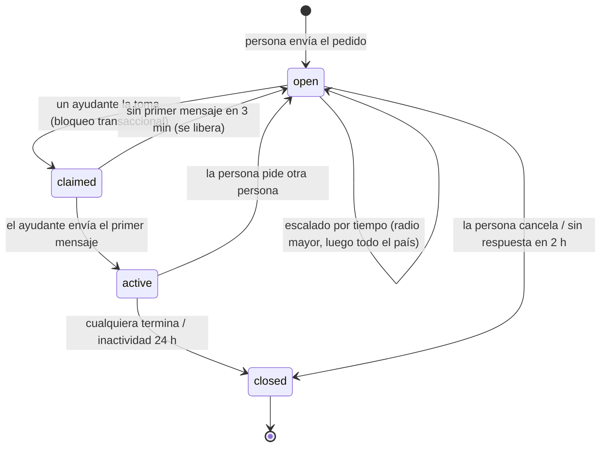

# 01 · Arquitectura

## Vista general

```
┌──────────────────────────────┐
│ apps/mobile (Expo + RN Web)  │  PWA ahora, iOS/Android después
└──────────────┬───────────────┘
               │ HTTPS (REST) + WebSocket (Socket.IO)
┌──────────────▼───────────────┐      ┌───────────────────────┐
│ apps/api (NestJS + Fastify)  │◄────►│ PostgreSQL 16+PostGIS │
│  módulos: auth, alerts,      │      └───────────────────────┘
│  chat, helpers, admin,       │      ┌───────────────────────┐
│  notifications, audit        │◄────►│ Redis (BullMQ, pub/sub│
└──────────────┬───────────────┘      │ Socket.IO adapter,    │
               │ jobs                 │ rate limiting)        │
┌──────────────▼───────────────┐      └───────────────────────┘
│ apps/api · worker.ts (NestJS standalone)│
│  escalado, timeouts, fan-out, │──► Web Push (VAPID) · FCM/APNs · Email · Telegram
│  borrado automático           │
└──────────────────────────────┘
```

## Monorepo

```
abrigo/
├── apps/
│   ├── mobile/          # Expo Router, RN Web, PWA (service worker propio)
│   ├── api/             # NestJS (HTTP + WebSocket) · src/worker.ts: consumidores BullMQ
│   ├── e2e/             # Playwright contra la API real y la PWA exportada
├── packages/
│   ├── shared/          # esquemas zod, tipos, constantes (líneas de crisis, estados)
│   ├── ui/              # tokens de DESIGN.md + componentes base
│   └── db/              # esquema Drizzle, migraciones, seeds
├── infra/terraform/     # GCP: Cloud Run, Cloud SQL, Memorystore, KMS, Secret Manager
├── docs/                # SDD y DESIGN.md
└── .github/workflows/   # CI/CD
```

Herramientas: pnpm workspaces + Turborepo, TypeScript estricto, ESLint + Prettier, Vitest, Playwright (E2E de la PWA), Testcontainers (Postgres/Redis reales en tests de integración).

## Stack

| Capa           | Tecnología                                                                                              |
| -------------- | ------------------------------------------------------------------------------------------------------- |
| Frontend       | Expo SDK (Expo Router), React Native Web, TanStack Query, Zustand                                       |
| Mapas          | `@vis.gl/react-google-maps` en web, `react-native-maps` en nativo (archivos `.web.tsx` / `.native.tsx`) |
| API            | NestJS sobre Fastify, validación con zod, OpenAPI generado                                              |
| Tiempo real    | Socket.IO + Redis adapter                                                                               |
| Datos          | PostgreSQL 16 + PostGIS, Drizzle ORM, migraciones versionadas                                           |
| Colas          | Redis + BullMQ                                                                                          |
| Auth           | Better Auth (sesión anónima, email+contraseña, TOTP, roles)                                             |
| Notificaciones | Web Push (VAPID) → FCM/APNs en nativo · Email (Resend o AWS SES) · Telegram Bot API                     |
| Antiabuso      | Cloudflare Turnstile (captcha invisible) + rate limiting en Redis                                       |
| Cifrado        | Cifrado de mensajes en la aplicación (AES-256-GCM, claves envueltas con Cloud KMS)                      |
| Observabilidad | Sentry, OpenTelemetry, logs estructurados (sin contenido de mensajes ni datos personales)               |
| Infra          | GCP `southamerica-east1`: Cloud Run, Cloud SQL, Memorystore, KMS, Secret Manager · Terraform            |
| CI/CD          | GitHub Actions: lint, typecheck, tests, migraciones, deploy                                             |

## Identidad

### Persona que pide ayuda (anónima)

- Al pedir ayuda se crea una **sesión anónima** ligada al dispositivo (implementación propia: token aleatorio de 256 bits; en la base solo queda su SHA-256; rota cada 24 h con 5 min de gracia para el anterior). El token se guarda en almacenamiento seguro (IndexedDB en web, SecureStore en nativo). Better Auth se usa solo para ayudantes y admin.
- No se guarda nombre, teléfono ni email. La IP se usa solo para limitar abusos y se guarda como hash con sal rotativa, con vida máxima de 24 h.
- "Borrar todo" elimina la sesión local y marca los datos del servidor para borrado inmediato.

### Ayudantes y admin

- Email + contraseña (Argon2id) + **TOTP obligatorio**.
- Roles: `helper_pending`, `helper`, `helper_suspended`, `admin`.
- Sesiones cortas con refresh; revocación inmediata al suspender.

## Ubicación y privacidad geográfica

- La persona **elige** si comparte una zona. Si acepta, el dispositivo obtiene la posición y **la reduce en el propio dispositivo** a una celda H3 de resolución 6 (~36 km², ~3,7 km de lado). Al servidor solo llega el índice H3. Sin permiso de ubicación, puede elegir provincia/partido desde una lista.
- Los ayudantes definen una **zona de cobertura** (centro aproximado + radio en km). Se guarda como `geography(Polygon)`.
- Coincidencia: alerta → celda H3 → centroide → `ST_DWithin` contra las zonas de cobertura.
- El mapa del ayudante muestra la celda como zona difusa; nunca un punto.

## Modelo de datos (núcleo)

```
anon_sessions(id, created_at, last_seen_at, push_subscription_id?, deleted_at?)

helpers(id, user_id, first_name, last_name, gender?, profession, license_number?,
        license_jurisdiction?, organization?, specialties[] -- 'mental_health'|'violence',
        languages[], bio_short, coverage geography(Polygon)?, accepts_remote_anywhere bool,
        max_concurrent smallint default 2, status, verified_by?, verified_at?, created_at)

helper_availability(helper_id, is_on_call bool, on_call_since, paused_until?)

verification_requests(id, helper_id, documents_ref[], notes, decision, decided_by, decided_at)

alerts(id, anon_session_id, path -- 'mental_health'|'violence',
       danger_now -- 'yes'|'unsure'|'no', safe_time_to_write?, helper_gender_pref?,
       h3_cell?, region_code?, language, status, escalation_level smallint,
       crisis_lines_shown_at, created_at, claimed_at?, closed_at?, close_reason?)

alert_claims(id, alert_id, helper_id, claimed_at, first_message_at?, released_at?, release_reason?)

conversations(id, alert_id, helper_id, anon_session_id, started_at, ended_at?, ended_by?)

messages(id, conversation_id, sender -- 'anon'|'helper'|'system',
         ciphertext bytea, nonce bytea, key_version int, created_at)

notifications(id, helper_id, alert_id, channel, status, sent_at, error?)

reports(id, conversation_id, reporter -- 'anon'|'helper', reason, details, status, created_at)

audit_log(id, actor_type, actor_id, action, target_type, target_id, metadata jsonb, created_at)
```

Índices clave: GIST sobre `helpers.coverage`; parcial sobre `alerts(status) WHERE status IN ('open','claimed')`; `messages(conversation_id, created_at)`.

## Ciclo de vida de una alerta



- **Tomar una alerta** usa `UPDATE alerts SET status='claimed' ... WHERE id=$1 AND status='open' RETURNING *`. Si no devuelve filas, otra persona la tomó primero.
- Los tiempos de escalado son jobs con demora en BullMQ (detalle en la etapa 2).

## Seguridad

| Amenaza                                       | Control                                                                                                   |
| --------------------------------------------- | --------------------------------------------------------------------------------------------------------- |
| Lectura de mensajes por filtración de la base | Cifrado en la aplicación con claves en KMS; rotación de claves                                            |
| Ayudante malicioso                            | Verificación manual, 2FA, límite de conversaciones, auditoría, reporte con un toque, suspensión inmediata |
| Spam de alertas                               | Turnstile, máximo 3 alertas por sesión cada 24 h, límite por hash de IP                                   |
| Robo de sesión anónima                        | Token rotativo, ligado al dispositivo, vida limitada                                                      |
| Ver el dispositivo de la víctima              | Salida rápida, sin historial visible, nombre/ícono discretos, botón "borrar todo"                         |
| Logs con datos sensibles                      | Lista explícita de campos permitidos en logs; nunca contenido de mensajes                                 |
| Acceso del personal a la infraestructura      | IAM mínimo, accesos a producción auditados, secretos en Secret Manager                                    |

## Retención de datos

| Dato                         | Retención                                                            |
| ---------------------------- | -------------------------------------------------------------------- |
| Mensajes                     | 30 días después de cerrar la conversación, luego se borran           |
| Mensajes con reporte abierto | Hasta resolver el reporte (máx. 90 días)                             |
| Alertas                      | Se anonimizan a los 30 días (se mantienen solo métricas agregadas)   |
| Sesiones anónimas            | Se borran a los 30 días sin actividad                                |
| Hash de IP                   | 24 h                                                                 |
| Datos de ayudantes           | Mientras la cuenta esté activa; 1 año después de la baja (auditoría) |

## Requisitos no funcionales

- Aviso al primer ayudante: p95 < 30 s desde que se crea la alerta.
- Entrega de mensajes del chat: p95 < 1 s.
- Disponibilidad objetivo: 99,5% mensual en el MVP.
- Accesibilidad WCAG 2.2 AA; flujo de crisis apuntando a AAA en texto.
- PWA instalable, usable en conexiones 3G y en celulares de gama baja (bundle inicial < 250 KB gzip en la ruta de pedido de ayuda).
- Toda la interfaz en español rioplatense, con textos centralizados para una futura traducción.
